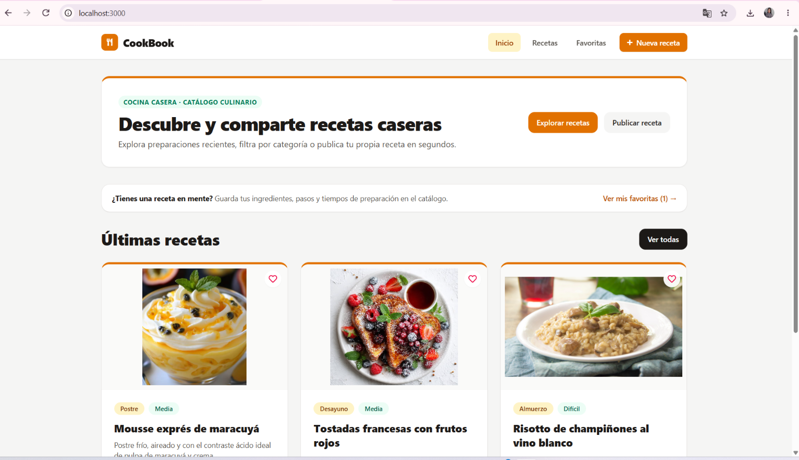
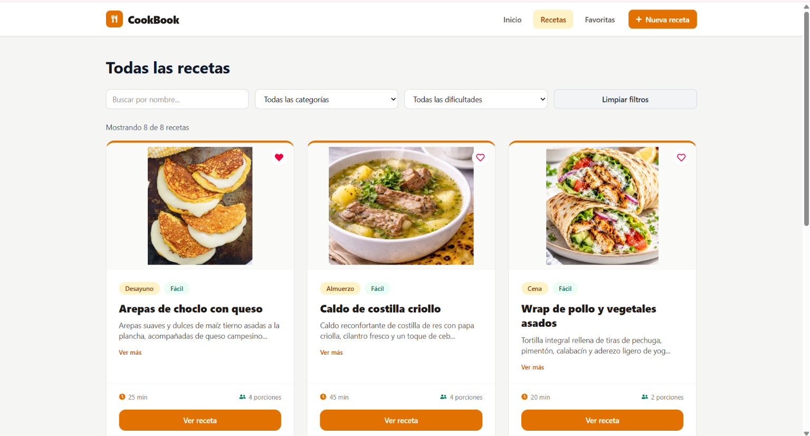
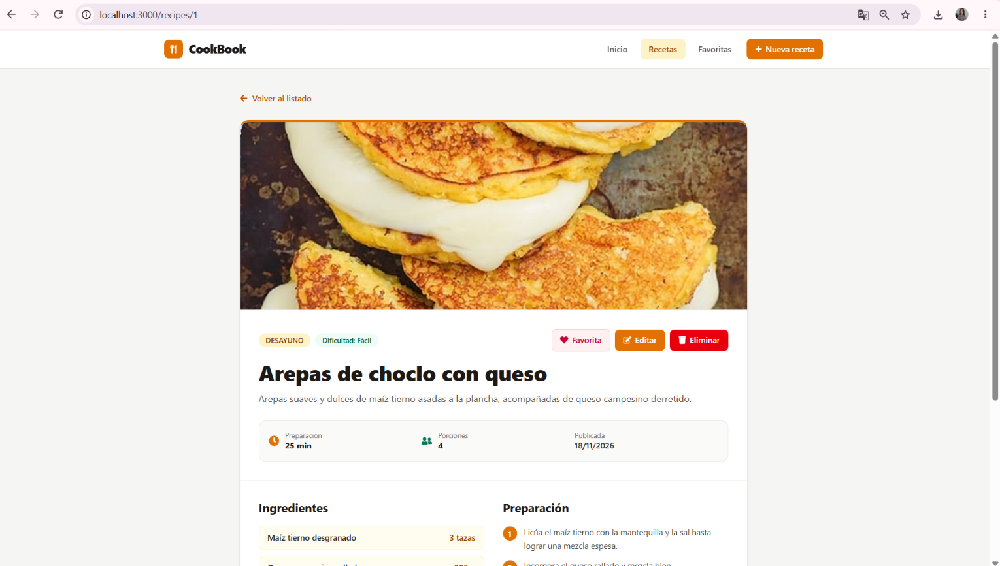
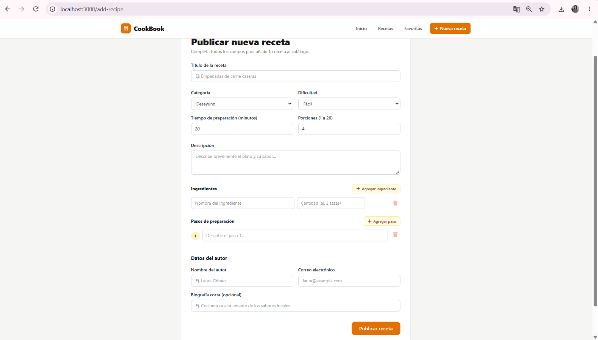

#  CookBook — Recetario Casero

Aplicación web de recetario casero desarrollada con **React 19, Vite, Tailwind CSS v4, React Router 7 y json-server** como API REST local.

CookBook permite explorar recetas recientes, consultar el catálogo completo con filtros y paginación, visualizar el detalle paso a paso de cada preparación, crear nuevas recetas, editar las existentes, eliminarlas con confirmación y gestionar recetas favoritas.

## Instalación y ejecución

### 1. Clonar el repositorio

```bash
git clone https://github.com/gsharik-hue/Proyecto-Recetario-React.git
cd Proyecto-Recetario-React/react19-cookbook
```

### 2. Instalar las dependencias

```bash
npm install
```

### 3. Iniciar el servidor de la API

En una terminal, ejecutar json-server en el puerto `5000`:

```bash
npm run server
```

### 4. Iniciar el servidor de desarrollo

En otra terminal, ejecutar Vite en `http://localhost:3000`, con proxy de `/api` hacia `http://localhost:5000`:

```bash
npm run dev
```

### 5. Ejecutar validaciones

Para comprobar el código y generar la compilación de producción:

```bash
npm run lint
npm run build
```

##   Funcionalidades implementadas

### Núcleo obligatorio

- [x] **RF-01 — Layout y navegación:** estructura principal mediante `MainLayout`, `Navbar` con `NavLink` y estado activo, `Outlet` y `ToastContainer` de `react-toastify`.
- [x] **RF-02 — Portada (`HomePage`):** componente `Hero`, tarjetas reutilizables `Card` con `children` y propiedades de estilo, visualización de las 3 recetas más recientes ordenadas por `createdAt` y enlace para consultar todas las recetas.
- [x] **RF-03 — Listado de recetas (`RecipesPage`):** carga asíncrona con `useEffect` y `fetch`, indicador `Spinner`, manejo de errores, estado vacío y componente `RecipeCard` con `key` estable. Incluye descripción expandible mediante las opciones «Ver más» y «Ver menos».
- [x] **RF-04 — Detalle de receta (`RecipeDetailPage`):** carga de información mediante `loader` de React Router, ingredientes, pasos numerados, información del autor y navegación de regreso.
- [x] **RF-05 — Crear receta (`AddRecipePage`):** formulario controlado, etiquetas `label` asociadas a sus campos, conversión de valores numéricos (`prepTime` y `servings`), objeto `author` anidado, petición `POST` y redirección después de recibir la respuesta del servidor.
- [x] **RF-06 — Editar receta (`EditRecipePage`):** carga previa mediante `loader`, formulario precargado, actualización mediante petición `PUT` y retorno al detalle con los cambios reflejados.
- [x] **RF-07 — Eliminar receta:** confirmación antes de eliminar, petición `DELETE`, notificación mediante toast y redirección al listado actualizado.
- [x] **RF-08 — Manejo de errores de ruta:** página `NotFoundPage` para rutas inexistentes y `errorElement` para gestionar recetas no encontradas o errores de carga.
- [x] **RF-09 — Diseño responsivo:** interfaz adaptable a diferentes tamaños de pantalla mediante utilidades de Tailwind CSS v4.

### Funcionalidades intermedias y retos de React 19

- [x] **RF-10 — Búsqueda y filtros combinables:** búsqueda por título y filtros por categoría y dificultad. Los resultados se calculan mediante estado derivado en cada renderizado.
- [x] **RF-12 — Recetas favoritas y respuesta optimista:** marcado y desmarcado de favoritas mediante `useOptimistic`, con persistencia en `db.json` a través de `PATCH /api/recipes/:id` y/o `localStorage` mediante `useLocalStorage`. Incluye una vista dedicada en `/favorites`.
- [x] **RF-13 — Validación de formularios:** mensajes de error debajo de cada campo. Se valida que el tiempo sea un número entero mayor que 0, las porciones estén entre 1 y 20, el correo electrónico sea válido y exista al menos un ingrediente y un paso.
- [x] **RF-14 — Paginación:** paginación aplicada sobre el listado previamente filtrado, con botones «Anterior» y «Siguiente» e indicador de página actual.
- [x] **RT-05 — Metadatos por página:** títulos del documento (`<title>`) definidos declarativamente en cada vista.
- [x] **RT-06 — Ref como propiedad normal en React 19:** componente reutilizable `Input` que recibe `ref` directamente como propiedad estándar, sin necesidad de utilizar `forwardRef`. Permite enfocar automáticamente el primer campo que presenta un error de validación.

## Tecnologías utilizadas

| Tecnología | Uso |
|---|---|
| React 19 | Construcción de interfaces y gestión de componentes. |
| Vite | Entorno de desarrollo y compilación. |
| Tailwind CSS v4 | Estilos y diseño responsivo. |
| React Router 7 | Navegación, rutas y loaders. |
| json-server | API REST local para gestionar las recetas. |
| React Toastify | Notificaciones visuales. |
| JavaScript | Lógica y funcionalidades de la aplicación. |

##  Decisiones técnicas y diseño

### Paleta de colores

Se eligió una paleta gastronómica cálida, evitando los tonos azules:

- **Amber:** acciones principales y acentos.
- **Emerald:** detalles frescos y elementos secundarios.
- **Rose:** identificación visual de recetas favoritas.
- **Stone y White:** superficies, bordes y fondos para facilitar la lectura.

El diseño sigue una estructura editorial limpia y permite destacar visualmente las imágenes de las recetas.

### Estado derivado

La búsqueda, los filtros y la paginación se calculan a partir del estado principal (`recipes`, `search`, `category`, `difficulty` y `currentPage`).

Se utilizan las variables derivadas `filteredRecipes` y `paginatedRecipes`, evitando duplicar estados innecesarios y modificar directamente el arreglo original.

### Centralización del acceso a datos

Todas las operaciones HTTP están centralizadas en:

`src/services/recipesApi.js`

Este archivo contiene las siguientes funciones:

- `getAllRecipes`
- `getLatestRecipes`
- `getRecipeById`
- `createRecipe`
- `updateRecipe`
- `patchRecipe`
- `toggleFavoriteRecipe`
- `deleteRecipe`

Cada operación comprueba explícitamente `response.ok` para gestionar correctamente los errores de las peticiones.

Además, el ordenamiento de las recetas recientes se realiza de forma segura en el cliente, utilizando la fecha `createdAt`.

### Configuración del proxy de Vite

En `vite.config.js` se configuró un proxy para redirigir las peticiones realizadas desde el frontend:

- Frontend: `http://localhost:3000`
- API: `http://localhost:5000`
- Ruta de acceso: `/api`

Esto permite trabajar con una URL más limpia y evitar configurar manualmente la dirección completa del servidor en cada petición.

## Problemas encontrados y soluciones

### 1. Diferencias entre mayúsculas y minúsculas en las rutas

Se presentó un conflicto al importar `recipesApi.js` debido a diferencias entre el nombre de la carpeta `Services` y la ruta de importación `services`.

**Solución:** se unificó el nombre de la carpeta y las importaciones, verificando que todas las funciones exportadas estuvieran correctamente definidas y sin residuos de código.

### 2. Ordenamiento de las recetas recientes

Se necesitaba mostrar consistentemente las tres recetas más recientes en la portada sin depender de los parámetros de ordenamiento de distintas versiones de `json-server`.

**Solución:** se centralizó el ordenamiento cronológico descendente mediante `createdAt` y el método `.slice(0, limit)` dentro de `getLatestRecipes`, en `recipesApi.js`.

### 3. Reglas de ESLint y compilación de producción

Durante el desarrollo se realizaron ajustes para cumplir las reglas de ESLint y garantizar que el proyecto pudiera compilarse correctamente.

**Solución:** se ejecutaron repetidamente los comandos `npm run lint` y `npm run build` hasta conseguir una compilación sin errores.

## Capturas de pantalla

### Portada


### Listado de recetas


### Detalle de receta


### Formulario de receta



## Autor

Proyecto desarrollado como práctica de aprendizaje y aplicación de conceptos modernos de **React 19**, gestión de estados, enrutamiento, consumo de API REST, formularios controlados y diseño responsivo.

---

**CookBook — Organiza tus recetas, descubre nuevos sabores y disfruta cocinando.** 